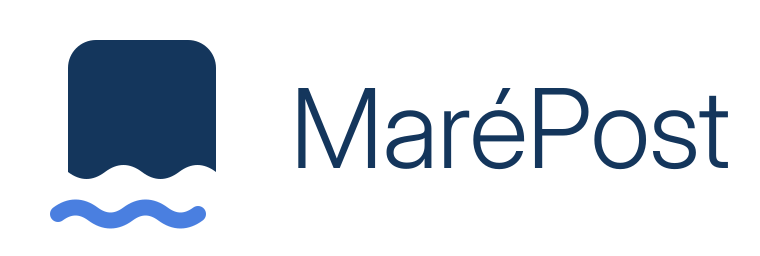

<p align="center">
  <picture>
    <source media="(prefers-color-scheme: dark)" srcset="./assets/brand/lockup-dark.svg">
    
  </picture>
</p>

<h3 align="center">Crie, agende e publique seus posts. No seu computador, do seu jeito.</h3>

<p align="center">
  MaréPost é uma ferramenta open source para escrever posts, criar imagens e vídeos<br>
  e agendar tudo para Instagram, LinkedIn e outras redes, rodando na sua própria máquina.
</p>

---

## O que dá para fazer

- **Conectar suas contas** de Instagram, LinkedIn, Facebook, X, TikTok, YouTube, Threads, Bluesky, Mastodon, Pinterest, Telegram, Discord e outras.
- **Escrever uma vez e adaptar** o texto e a mídia para cada rede, com pré-visualização.
- **Agendar** num calendário ou numa fila, com horários livres automáticos.
- **Editar imagens e carrosséis** com camadas, modelos e remoção de fundo no navegador.
- **Editar vídeos** com linha do tempo, legendas, cortes pelo texto falado e gravador de tela.
- **Responder comentários e mensagens** sem trocar de app.
- **Ver resultados** de cada post e de cada conta.
- **Automatizar** com workflows (RSS, releases do GitHub, prompts agendados) e com IA opcional.
- **Usar com assistentes de IA** via MCP (Claude, ChatGPT, Cursor e outros), API, CLI e n8n.

## Instalar

Você precisa do [Docker](https://docs.docker.com/get-docker/) instalado.

```bash
git clone https://github.com/MacrosSilva/marepost.git
cd marepost
cp .env.example .env
docker compose up -d
```

Abra **http://localhost:8080** e crie a sua conta. Cada pessoa roda a sua própria cópia: seus dados, suas contas e suas mídias ficam só no seu computador.

> A imagem `ghcr.io/macrossilva/marepost` é gerada automaticamente pelo GitHub a cada atualização, então você não precisa compilar nada.

### Conectar Instagram e LinkedIn

As redes sociais exigem que você crie um "app" de desenvolvedor gratuito em cada uma e um endereço HTTPS público para a sua instalação (o [Cloudflare Tunnel](https://developers.cloudflare.com/cloudflare-one/connections/connect-networks/) resolve de graça). O passo a passo de cada rede está na documentação do projeto original, que vale igual para o MaréPost:

- [Instagram](https://openpo.st/docs/self-hosting/integrations/instagram): a conta precisa ser **Profissional** (Criador ou Comercial).
- [LinkedIn](https://openpo.st/docs/self-hosting/integrations/linkedin)
- [Todas as redes](https://openpo.st/docs/self-hosting/integrations)

As variáveis de configuração continuam com o prefixo `OPENPOST_` (por exemplo `OPENPOST_APP_URL`), para manter compatibilidade com o projeto original.

### Privacidade

No MaréPost, a telemetria e o envio de diagnósticos de erro vêm **desligados**. Nada é enviado para fora da sua instalação, a não ser os posts que você publica nas redes que conectou.

## De onde vem

O MaréPost é um fork do **[OpenPost](https://github.com/getopenpost/openpost)**, criado pelos mantenedores do OpenPost e colaboradores, com outro nome, outra identidade visual e configurações padrão voltadas para uso pessoal. Todo o trabalho pesado (publicação, editores, workflows, integrações) é deles. Se este projeto for útil para você, considere dar uma estrela no repositório original.

Diferenças em relação ao OpenPost:

- Nome, logo e cores (azul) próprios.
- Telemetria e diagnósticos desligados por padrão.
- Imagem Docker própria, gerada pelo GitHub Actions deste repositório.
- Material de divulgação do projeto original removido.

## Feito com a ajuda do Claude Code

A adaptação de marca, a identidade visual e esta documentação foram feitas com a ajuda do [Claude Code](https://claude.com/claude-code).

## Licença

[GNU AGPL-3.0](./LICENSE), a mesma do OpenPost. Você pode usar, modificar e redistribuir, desde que o código das suas modificações continue aberto, inclusive se você oferecer a ferramenta para outras pessoas pela internet. Os avisos de copyright do projeto original estão preservados; veja também [NOTICE.md](./NOTICE.md).

O nome e a marca "OpenPost" pertencem aos seus donos e não fazem parte desta licença de uso de marca.
