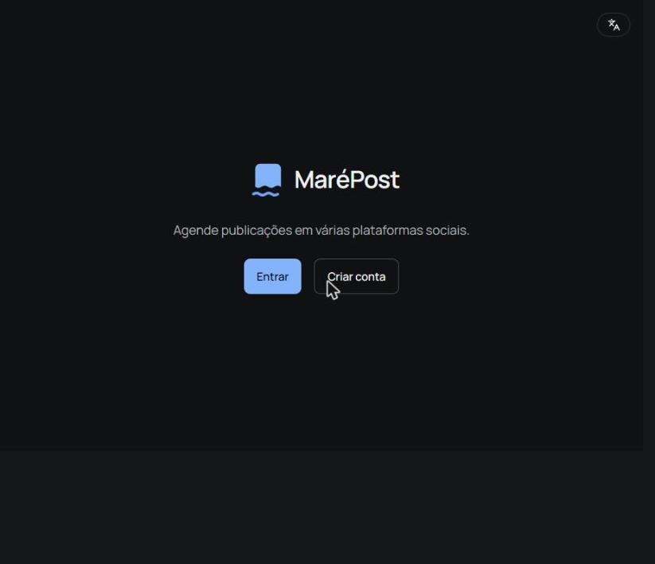
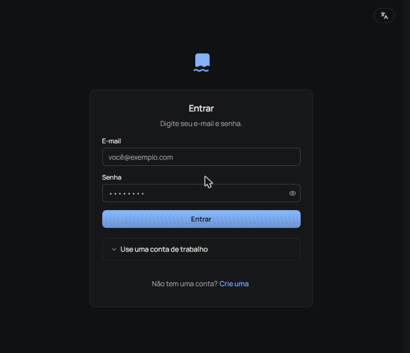
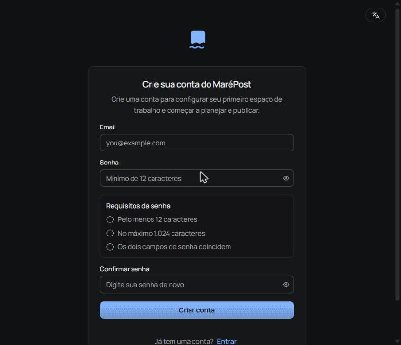
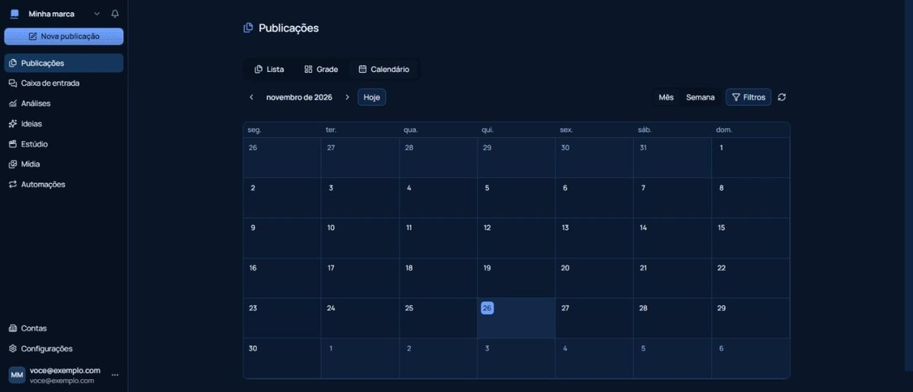
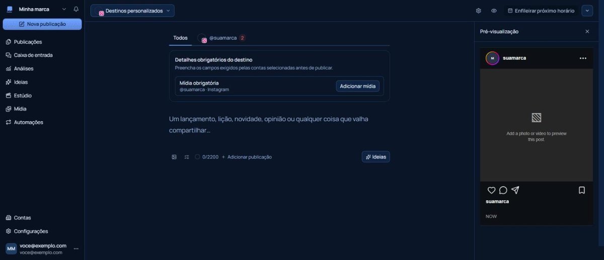
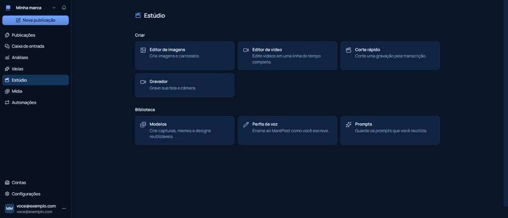
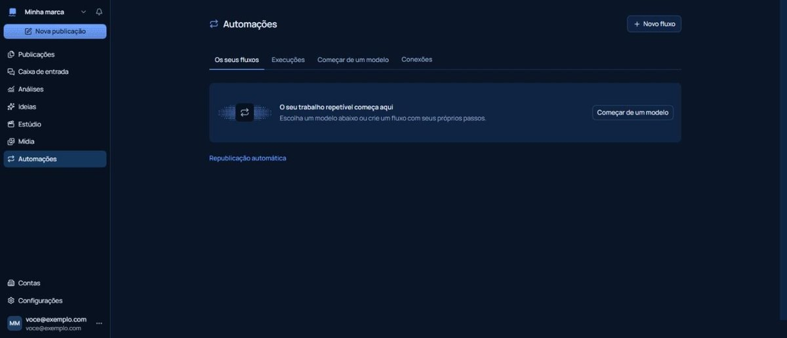
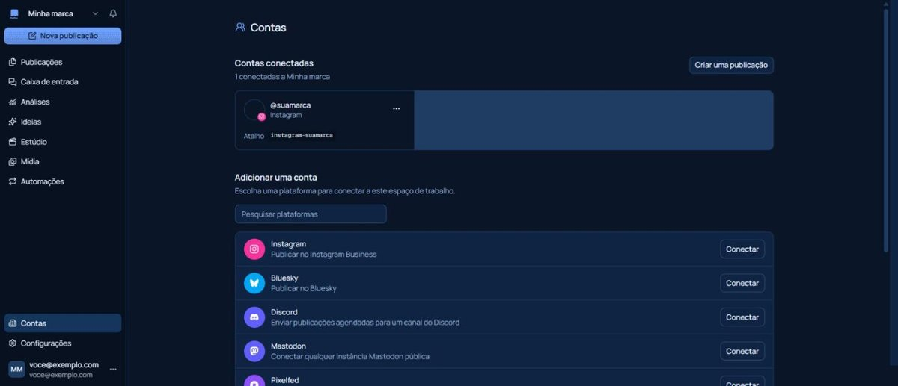

<p align="center">
  <picture>
    <source media="(prefers-color-scheme: dark)" srcset="./assets/brand/lockup-dark.svg">
    
  </picture>
</p>

<h3 align="center">Crie, agende e publique seus posts. No seu computador, do seu jeito.</h3>

<p align="center">
  MaréPost é uma ferramenta open source para escrever posts, criar imagens e vídeos<br>
  e agendar tudo para Instagram, LinkedIn e outras redes, rodando na sua própria máquina.
</p>

---

## O que dá para fazer

- **Conectar suas contas** de Instagram, LinkedIn, Facebook, X, TikTok, YouTube, Threads, Bluesky, Mastodon, Pinterest, Telegram, Discord e outras.
- **Escrever uma vez e adaptar** o texto e a mídia para cada rede, com pré-visualização.
- **Agendar** num calendário ou numa fila, com horários livres automáticos.
- **Editar imagens e carrosséis** com camadas, modelos e remoção de fundo no navegador.
- **Editar vídeos** com linha do tempo, legendas, cortes pelo texto falado e gravador de tela.
- **Responder comentários e mensagens** sem trocar de app.
- **Ver resultados** de cada post e de cada conta.
- **Automatizar** com workflows (RSS, releases do GitHub, prompts agendados) e com IA opcional.
- **Usar com assistentes de IA** via MCP (Claude, ChatGPT, Cursor e outros), API, CLI e n8n.

## Telas

<p align="center">
  
  
  
</p>

<p align="center">
  
  
  
  
  
</p>

<sub>Nome e e-mail nas telas internas são de exemplo.</sub>

## Instalar

Você precisa do [Docker](https://docs.docker.com/get-docker/) instalado.

```bash
git clone https://github.com/MacrosSilva/marepost.git
cd marepost
cp .env.example .env
docker compose up -d
```

Abra **http://localhost:8080** e crie a sua conta. Cada pessoa roda a sua própria cópia: seus dados, suas contas e suas mídias ficam só no seu computador.

> A imagem `ghcr.io/macrossilva/marepost` é gerada automaticamente pelo GitHub a cada atualização, então você não precisa compilar nada.

## Usar de graça, com as redes conectadas

Dá para usar o MaréPost com Instagram, LinkedIn e IA **sem pagar nada**: sem domínio, sem servidor e sem serviço de terceiros. É o caminho abaixo. Os endereços e números são **exemplos**: troque pelos seus.

> **Importante:** como o MaréPost roda no seu computador, os posts agendados só saem com o **PC ligado** e o Docker rodando.

### 1. Endereço público grátis (Tailscale Funnel)

Instagram e LinkedIn só aceitam um endereço **HTTPS público e fixo**: o login volta para ele, e a Meta baixa as fotos dele para publicar. `localhost` não serve. O [Tailscale Funnel](https://tailscale.com/kb/1223/funnel) dá esse endereço de graça, sem comprar domínio:

1. Instale o [Tailscale](https://tailscale.com/download) e entre com uma conta (Google serve).
2. Dê um nome à máquina (é ele que aparece no endereço) e publique a porta do MaréPost:

   ```bash
   tailscale set --hostname=marepost
   tailscale funnel --bg 8080
   ```

   Na primeira vez, o Tailscale mostra um link para você **liberar o Funnel** na sua conta. Depois disso, o comando mostra o endereço, no formato `https://marepost.seu-tailnet.ts.net`. Ele não muda e volta sozinho quando o PC reinicia.

3. No `.env`, coloque esse endereço e, como o site fica aberto na internet, **feche os cadastros** depois de criar a sua conta:

   ```dotenv
   OPENPOST_APP_URL=https://marepost.seu-tailnet.ts.net
   OPENPOST_PUBLIC_URL=https://marepost.seu-tailnet.ts.net
   OPENPOST_TRUSTED_PROXY_CIDRS=172.16.0.0/12
   OPENPOST_DISABLE_REGISTRATIONS=true
   ```

4. Recrie o container: `docker compose up -d --force-recreate`. A partir daí, use sempre o endereço novo (inclusive para entrar).

> Por que não o Cloudflare Tunnel? Ele só é grátis **com endereço fixo** se você tiver um domínio próprio. Sem domínio, o endereço `trycloudflare.com` muda a cada reinício e você teria que reconfigurar as redes toda vez.

### 2. Instagram (app grátis na Meta)

Antes de tudo, a conta do Instagram precisa ser **profissional** (Criador de conteúdo ou Comercial) e estar **ligada a uma Página do Facebook** (no app do Instagram: *Editar perfil → Página*).

1. Em [business.facebook.com](https://business.facebook.com), crie um **portfólio empresarial** (grátis) e coloque a Página nele.
2. Em [developers.facebook.com/apps](https://developers.facebook.com/apps), crie um app com o caso de uso **"Gerenciar mensagens e conteúdo no Instagram"** e ligue o app ao portfólio.
3. No caso de uso, deixe as permissões `instagram_basic`, `instagram_content_publish`, `instagram_manage_comments`, `instagram_manage_messages`, `pages_show_list`, `pages_read_engagement` e `business_management` como **"Pronto para teste"**.
4. Em **Login do Facebook para Empresas → Configurações**, adicione a URL de redirecionamento e salve:
   `https://marepost.seu-tailnet.ts.net/api/v1/accounts/instagram/callback`
5. Em **Login do Facebook para Empresas → Configurações (modelos/configurações)**, crie uma configuração com **token de acesso do usuário** e as permissões acima. Anote o **ID da configuração**.
6. Em **Configurações do app → Básico**, coloque o endereço em **Domínios do app** (`marepost.seu-tailnet.ts.net`) e adicione a plataforma **Site** com a URL `https://marepost.seu-tailnet.ts.net/`.
7. No `.env`, numa linha só (o segredo fica em *Configurações do app → Básico → Chave secreta do aplicativo*):

   ```dotenv
   OPENPOST_PROVIDER_APPS='[{"provider":"instagram","client_id":"ID_DO_APP","client_secret":"CHAVE_SECRETA","redirect_uri":"https://marepost.seu-tailnet.ts.net/api/v1/accounts/instagram/callback","config_id":"ID_DA_CONFIGURACAO"}]'
   ```

8. Recrie o container e, no MaréPost, vá em **Contas → Instagram → Continuar com o Facebook**.

O app pode ficar em **modo de desenvolvimento**: como administrador dele, você consegue publicar nas suas próprias contas sem passar pela análise da Meta.

**Se der erro:**
- *"O domínio dessa URL não está incluído nos domínios do app"*: falta o passo 6.
- A Meta às vezes mostra "salvo" e não grava a URL de redirecionamento. Recarregue a página do passo 4 e confira se ela continua lá.

### 3. LinkedIn

O LinkedIn exige que o app de desenvolvedor fique ligado a uma **Página de empresa** que você administra. É só uma formalidade de cadastro: os posts saem no seu **perfil pessoal**.

- Contas com **poucas conexões** não conseguem criar Página ("Recurso indisponível"). Nesse caso, faça mais conexões e tente depois.
- Com a Página criada, siga o [guia do LinkedIn](https://openpo.st/docs/self-hosting/integrations/linkedin): produtos *Sign In with LinkedIn using OpenID Connect* e *Share on LinkedIn*, redirecionamento `https://marepost.seu-tailnet.ts.net/api/v1/accounts/linkedin/callback`, e `OPENPOST_DISABLE_LINKEDIN_THREAD_REPLIES=true` no `.env`.
- Junte a entrada do LinkedIn **na mesma lista** do `OPENPOST_PROVIDER_APPS` do Instagram.

As outras redes estão no [guia de integrações](https://openpo.st/docs/self-hosting/integrations) do projeto original, que vale igual para o MaréPost.

### 4. IA local e grátis (Ollama)

As funções de IA (ideias, escrever posts, automações) podem usar o [Ollama](https://ollama.com) no seu próprio PC, sem pagar API nenhuma:

1. Instale o Ollama e baixe um modelo, por exemplo `ollama pull qwen3:8b`.
2. Se a placa de vídeo tiver pouca memória (6 GB, por exemplo), crie uma versão com contexto menor, que fica bem mais rápida:

   ```bash
   printf 'FROM qwen3:8b\nPARAMETER num_ctx 8192\n' > Modelfile
   ollama create marepost-ia -f Modelfile
   ```

3. No `.env`:

   ```dotenv
   OPENPOST_AI_API_KEY=ollama
   OPENPOST_AI_BASE_URL=http://host.docker.internal:11434/v1
   OPENPOST_TEXT_GENERATION_MODEL=marepost-ia
   OPENPOST_WORKFLOW_DECISION_MODEL=marepost-ia
   OPENPOST_MEME_GENERATION_MODEL=marepost-ia
   OPENPOST_IMAGE_CAPTION_MODEL=marepost-ia
   OPENPOST_WORKFLOWS_AI_MONTHLY_CALL_LIMIT=0
   ```

O que esperar: numa placa de 6 GB, cada texto leva uns 30 segundos, e o PC fica pesado enquanto gera. Um modelo de 8B escreve bem o básico, mas revise antes de publicar. A descrição automática de imagens só funciona com um modelo que enxergue imagens (por exemplo `qwen2.5vl`).

### Configuração

As variáveis continuam com o prefixo `OPENPOST_` (por exemplo `OPENPOST_APP_URL`), para manter compatibilidade com o projeto original. O `.env` guarda segredos: ele já está no `.gitignore` e **nunca deve ir para o GitHub**.

### Privacidade

No MaréPost, a telemetria e o envio de diagnósticos de erro vêm **desligados**. Nada é enviado para fora da sua instalação, a não ser os posts que você publica nas redes que conectou.

## De onde vem

O MaréPost é um fork do **[OpenPost](https://github.com/getopenpost/openpost)**, criado pelos mantenedores do OpenPost e colaboradores, com outro nome, outra identidade visual e configurações padrão voltadas para uso pessoal. Todo o trabalho pesado (publicação, editores, workflows, integrações) é deles. Se este projeto for útil para você, considere dar uma estrela no repositório original.

Diferenças em relação ao OpenPost:

- Nome, logo e cores (azul) próprios.
- Telemetria e diagnósticos desligados por padrão.
- Imagem Docker própria, gerada pelo GitHub Actions deste repositório.
- Automações (GitHub Actions) do projeto original substituídas por uma só, que gera a imagem Docker.

## Feito com a ajuda do Claude Code

A adaptação de marca, a identidade visual e esta documentação foram feitas com a ajuda do [Claude Code](https://claude.com/claude-code).

## Licença

[GNU AGPL-3.0](./LICENSE), a mesma do OpenPost. Você pode usar, modificar e redistribuir, desde que o código das suas modificações continue aberto, inclusive se você oferecer a ferramenta para outras pessoas pela internet. Os avisos de copyright do projeto original estão preservados; veja também [NOTICE.md](./NOTICE.md).

O nome e a marca "OpenPost" pertencem aos seus donos e não fazem parte desta licença de uso de marca.
